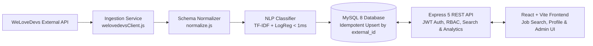

# JobSeeker (Job Aggregator) — Full-Stack Job Platform, Data Pipeline & NLP Classifier

JobSeeker is an end-to-end **full-stack job aggregation platform** featuring an automated **WeLoveDevs data ingestion & normalization pipeline**, an in-memory **NLP job category classifier** (`TF-IDF + Logistic Regression`), a **Node.js / Express 5 REST API** backed by **MySQL 8**, a **React + Vite frontend**, **Docker Compose** orchestration, and **GitHub Actions CI**.

---

## Key Features

- **Automated Data Ingestion & Normalization Pipeline (`backend/src/services/`):**
  - Fetches live job offers from the external **WeLoveDevs API** (`welovedevsClient.js`).
  - Normalizes heterogeneous job records into a unified internal schema (`normalize.js`) and performs idempotent **MySQL upserts** keyed by `external_id` (`offerIngestionService.js`).
- **NLP Job Category Classification (`ml/`, `backend/src/utils/classifier.js`):**
  - Trained a **TF-IDF (unigrams + bigrams) + Logistic Regression** classifier in Python (`ml/train_classifier.ipynb`) across **10 tech job categories** (`Frontend`, `Backend`, `Fullstack`, `Data & AI`, `DevOps & Cloud`, `Mobile`, `Cybersecurity`, `Embedded & Hardware`, `Project Management`, `Other`).
  - Exported model weights to JSON/ONNX (`ml/classifier.json`, `ml/classifier.onnx`) for sub-millisecond (`< 1 ms`) zero-dependency inference directly inside Node.js during offer ingestion.
- **Secure REST API & Role-Based Access Control (`backend/`):**
  - **Authentication (`/api/auth`):** User registration and login with `bcrypt` password hashing (10 rounds), JWT bearer tokens, and login rate-limiting.
  - **Offers & Analytics (`/api/offers`, `/api/analytics`):** Full-text search (`q`), filtering by `location`, `contract_type` (`CDI`, `CDD`, `INTERNSHIP`, `APPRENTICESHIP`, `FREELANCE`), `source`, and pagination (`limit`, `offset`).
  - **Admin Dashboard API (`/api/admin`):** RBAC-protected routes (`ADMIN` role) for managing users, roles, and offer visibility (`is_active` soft-delete).
- **React + Vite Frontend (`Frontend/`):**
  - Responsive web interface with job search & filtering (`Home.jsx`), detailed offer view (`OfferDetail.jsx`), user authentication (`Login.jsx`, `register.jsx`, `Profile.jsx`), and an administration console (`Admin.jsx`).
- **DevOps & Quality Assurance (`.github/workflows/ci.yml`, `docker-compose.yml`):**
  - Multi-container **Docker Compose** setup (`database`, `backend`, `frontend`), **Jest** test suite (`backend/src/__tests__/`), ESLint, and automated **Lighthouse** accessibility & performance audits.

---

## System Architecture



---

## Project Structure

```text
jobseeker/
├── backend/
│   ├── sql/init.sql                        # MySQL schema initialization (users & offers tables)
│   ├── src/
│   │   ├── app.js                          # Express 5 application setup & middleware
│   │   ├── config/db.js                    # MySQL connection pool (mysql2/promise)
│   │   ├── controllers/                    # Auth, Offers, Ingestion, Analytics & Admin controllers
│   │   ├── middleware/                     # JWT auth, RBAC & centralized error handler
│   │   ├── routes/                         # REST API route definitions
│   │   ├── services/                       # WeLoveDevs HTTP client & ingestion pipeline
│   │   ├── utils/                          # Data normalizer & Node.js TF-IDF/LogReg classifier
│   │   └── __tests__/                      # Jest unit & integration tests
│   ├── Dockerfile
│   └── package.json
├── Frontend/
│   ├── src/                                # React components (Home, OfferDetail, Login, Profile, Admin)
│   ├── Dockerfile
│   └── package.json
├── ml/
│   ├── train_classifier.ipynb              # Python scikit-learn training notebook
│   ├── classifier.json                     # Exported TF-IDF + Logistic Regression weights for Node.js
│   ├── classifier.onnx                     # ONNX exported model artifact
│   ├── classes.json                        # 10 job classification categories
│   └── confusion_matrix.png                # Evaluation confusion matrix
├── docs/                                   # Detailed technical, API, data-pipeline & audit docs
├── docker-compose.yml                      # Full-stack Docker orchestration
├── .github/workflows/ci.yml                # Automated GitHub Actions CI pipeline
└── README.md
```

---

## Quick Start

### 1. Clone & Configure Environment

```bash
git clone https://github.com/AlexandrG1209/jobseeker.git
cd jobseeker
cp .env.example .env
```

Set your `WELOVEDEVS_API_KEY` and `JWT_SECRET` in `.env` (or `backend/.env`).

### 2. Run with Docker Compose

```bash
docker compose up -d
```

- **Frontend UI:** `http://localhost:3000`
- **Backend API:** `http://localhost:4000` (`GET /ping` → `{"status":"ok"}`)
- **MySQL 8 Database:** `localhost:3306`

### 3. Local Development & Testing (Backend)

```bash
cd backend
npm install
npm run dev       # Start Express server on port 4000
npm test          # Run Jest test suite
npm run lint      # Run ESLint
```

### 4. Trigger WeLoveDevs Ingestion & Query Offers

```bash
# Import 10 job offers matching "python" from WeLoveDevs
curl -X POST http://localhost:4000/api/ingestion/welovedevs \
  -H "Content-Type: application/json" \
  -d '{"q":"python","size":10,"page":0}'

# Search normalized & classified offers
curl "http://localhost:4000/api/offers?q=python&limit=10"
```

---

## Tech Stack

- **Backend:** Node.js, Express.js 5, MySQL 8 (`mysql2`), JWT (`jsonwebtoken`), `bcryptjs`, Helmet, Jest
- **Frontend:** React, Vite, CSS3
- **Machine Learning / NLP:** Python, `scikit-learn` (TF-IDF + Logistic Regression), ONNX, custom Node.js inference engine
- **DevOps:** Docker, Docker Compose, GitHub Actions CI, Lighthouse

---

## Contributors

- **Alexandr Gorlachev** (Data Ingestion Pipeline, Normalization, MySQL Upserts & Backend API) — [@AlexandrG1209](https://github.com/AlexandrG1209)
- **Mathieu Jin** — [@Hirukiu](https://github.com/Hirukiu)
- **Mattis Philippe** — [@Mattis-Philippe](https://github.com/Mattis-Philippe)
- **Léon Zhou** — [@moamoa701](https://github.com/moamoa701)
